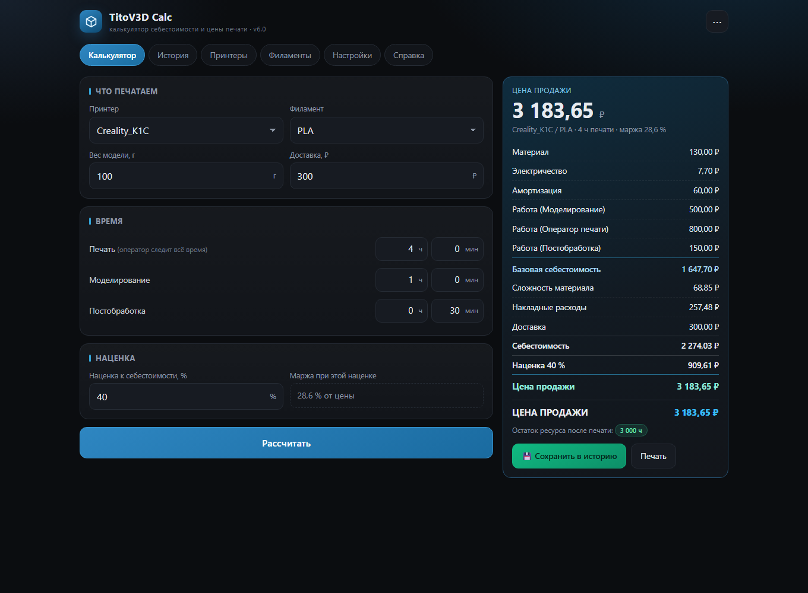
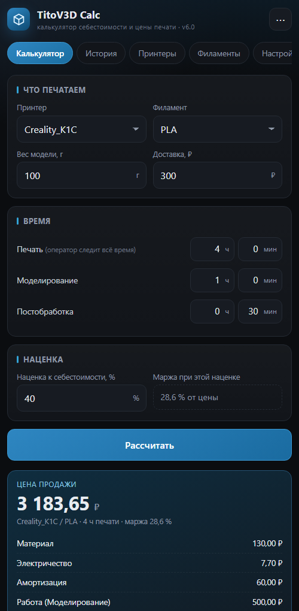

# TitoV3D Calc

Калькулятор себестоимости и цены 3D-печати: однофайловое веб-приложение, Windows-сборка на Tauri и Android-приложение на Capacitor.

Приложение выросло из Tkinter-утилиты `TitoV3D Calculator v3.9` и полностью повторяет её расчётную логику: материал, электричество, амортизация принтера, работа (моделирование, оператор печати, постобработка), наценка за сложность материала, накладные расходы, доставка и торговая наценка.



<p align="center">
  
</p>

**Версия 6.1.0** · Windows `.exe` / `.msi` / установщик NSIS · Android `versionCode 610`, `minSdk 24` (Android 7.0+)

🌐 **Демо в браузере:** https://niki0zz.github.io/titov3d-calc/

---

## Возможности

| Блок | Что умеет |
|---|---|
| Калькулятор | Принтер, филамент, вес модели, доставка, три таймера (ч/мин), наценка в % и живая подсказка маржи |
| Результат | Полная раскладка себестоимости, сумма наценки, цена продажи, остаток ресурса принтера после печати |
| История | Сохранение расчётов, удаление записи, полная очистка, экспорт в CSV, сводка по заказам |
| Принтеры | CRUD, мощность, цена, основной ресурс; **динамический** остаток = ресурс − сумма времени печати из истории |
| Филаменты | CRUD, цена катушки, вес, коэффициент сложности; поиск и группировка по категориям |
| Каталог | 40 FDM-материалов с ценами и коэффициентами сложности (точка отсчёта PLA = 1.50) |
| Настройки | Пять тарифов и ставок, определение платформы (Windows / Android / браузер) |
| Данные | Экспорт/импорт `3d_calc_data_v2.json` — совместим с Python-версией; автосохранение в `localStorage` |

## Формулы

```
материал      = г × (цена_катушки / (вес_катушки × 1000))
электричество = Вт/1000 × часы_печати × тариф
амортизация   = (цена_принтера / ресурс_ч) × часы_печати
работа        = моделирование + оператор(всё время печати) + постобработка
база          = материал + электричество + амортизация + работа
сложность     = (материал + электричество) × (коэф_сложности − 1)
накладные     = (база + сложность) × коэф_накладных
себестоимость = база + сложность + накладные + доставка
цена          = себестоимость × (1 + наценка% / 100)
маржа         = (цена − себестоимость) / цена × 100
```

### Проверочный пример

Creality_K1C (350 Вт, 45 000 ₽, ресурс 3000 ч) · PLA (1300 ₽/кг, сложность 1.50) · 100 г · печать 4 ч · моделирование 1 ч · постобработка 30 мин · доставка 300 ₽ · наценка 40 %:

```
Материал                    130,00
Электричество                 7,70
Амортизация                  60,00
Моделирование               500,00
Оператор печати             800,00
Постобработка               150,00
--- база ---              1 647,70
Сложность (PLA 1.50)         68,85
Накладные 15 %              257,48
Доставка                    300,00
СЕБЕСТОИМОСТЬ             2 274,03
Наценка 40 %                909,61
ЦЕНА                      3 183,65 ₽   (маржа 28,6 %)
```

Этот же расчёт зафиксирован на скриншоте выше.

## Быстрый старт

**Браузер / Windows.** Открыть `app/web/index.html` двойным кликом или через `Открыть калькулятор.bat`. Установка, Python и права администратора не нужны.

**Android.** Скачать `releases/TitoV3D-Calc-6.1.0-android.apk` и установить (разрешить установку из неизвестных источников). Если появляется «пакет недействителен» — сверить размер и SHA-256 по [`docs/INSTALL.md`](docs/INSTALL.md). Альтернатива без установки — открыть `index.html` в Chrome и выбрать «Добавить на главный экран».

**Сборка из исходников.** Инструкции с зависимостями и командами — в [`docs/BUILD.md`](docs/BUILD.md).

## Сборки

| Файл | Назначение | Размер |
|---|---|---|
| `TitoV3D-Calc-6.1.0-x64-setup.exe` | Установщик Windows (NSIS) | 1.3 МБ |
| `TitoV3D-Calc-6.1.0-x64.msi` | MSI-пакет для развёртывания | 2.0 МБ |
| `TitoV3D-Calc-6.1.0-portable.exe` | Портативный бинарник, без установки | 4.2 МБ |
| `TitoV3D-Calc-6.1.0-android.apk` | Подписанный APK (v2 + v3), Android 7+ | 3.2 МБ |

Контрольные суммы — [`releases/SHA256SUMS.txt`](releases/SHA256SUMS.txt).

```powershell
Get-FileHash .\TitoV3D-Calc-6.1.0-x64-setup.exe -Algorithm SHA256
```

## Структура репозитория

```
.
├── app/
│   ├── web/            # веб-версия 6.1 — весь калькулятор в одном index.html
│   ├── legacy-web/     # первая веб-версия (4.x), сохранена для истории
│   ├── desktop/        # обёртка Tauri 2 + Rust для Windows (src-tauri, без target/)
│   └── android/        # Capacitor-проект: www/, android/, конфиги
├── docs/
│   ├── PROJECT.md      # описание порта, отличия от Tkinter-версии
│   ├── REVIEW.md       # аудит логики и защиты, найденные баги
│   ├── FILAMENTS.md    # методика коэффициентов сложности, каталог 40 материалов
│   ├── PORTING.md      # план переноса на Windows и Android
│   ├── BUILD.md        # сборка: Rust, Tauri, Android SDK, подпись APK
│   ├── REPORT.md       # отчёт о тестировании
│   ├── INSTALL.md      # установка APK и разбор ошибок установки
│   ├── MCP.md          # MCP-сервер для работы с калькулятором из агента
│   └── screenshots/    # скриншоты интерфейса
├── releases/           # собранные артефакты + SHA256SUMS.txt
└── README.md
```

## Документация

- [Аудит логики и защита](docs/REVIEW.md) — что исправлено после проверки формул
- [Коэффициенты материалов](docs/FILAMENTS.md) — методика и таблица 40 FDM-пластиков
- [План переноса](docs/PORTING.md) — Windows (Tauri) и Android (Capacitor)
- [Сборка](docs/BUILD.md) — от установки Rust/Android SDK до подписи APK
- [Отчёт о тестах](docs/REPORT.md) — проверенные сценарии и результаты
- [Установка APK](docs/INSTALL.md) — сверка хеша и разбор «пакет недействителен»
- [MCP-сервер](docs/MCP.md) — управление калькулятором из агента

## Защита и устойчивость

- Числа ограничены разумными диапазонами; отрицательные и «бесконечные» значения не ломают расчёт и подсвечивают поле.
- Деление на ноль (вес катушки, ресурс, цена) даёт 0 с предупреждением, а не `∞`.
- Повторное сохранение того же расчёта блокируется по физическим параметрам печати — ресурс не списывается дважды.
- Импорт JSON защищён от загрязнения прототипа (`__proto__`, `constructor`), ограничен по размеру и проверяется по структуре.
- Перед импортом и сбросом автоматически создаётся резервная копия с возможностью отката.
- CSV экранирует формулы (`=`, `+`, `-`, `@`), чтобы имена не исполнялись в Excel.
- Принтер или филамент, на который ссылается история, нельзя удалить.

## Технологии

`HTML/CSS/JS` (без фреймворков и сборки) · `Tauri 2` + `Rust` · `Capacitor 6` + `Android Gradle` · `localStorage` и JSON-обмен с Python-версией

## Как это сделано

Проект собран по итогам одной сессии в OpenCode 24.10.2026 (~2 часа работы, 8 запросов): поиск Android-слайсера → калькулятор на HTML/JS → аудит логики и защиты → блок наценки и каталог 40 материалов → план порта на Windows/Android → сборка Tauri и APK → финальная проверка и документация.

Материалы сессии — транскрипт, исходный Python-код и рассуждения модели — в публичный репозиторий не включены.

## Примечания

- `localStorage` может очиститься при очистке данных сайта — для бэкапа используйте «Экспорт данных».
- Ключ подписи Android (`tito-release.jks`) и `local.properties` в репозиторий намеренно не включены: без keystore APK нужно пересобирать и подписывать своим ключом.
- Публикуемые сборки собраны под Windows x64; для других платформ исходники в `app/desktop` и `app/android` собираются по [`docs/BUILD.md`](docs/BUILD.md).
